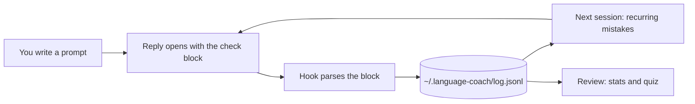

# Language Coach

**Learn a language while you code.** Write your prompts to Claude Code or Cursor in the language you are learning. Before every answer, the AI corrects your spelling, grammar and phrasing, then does the task as usual. Every correction is logged on your machine, so you can see your progress and get quizzed on the mistakes you keep making.

It works with any language. Set it to English, German, Spanish, or whatever you are learning.

- [What it looks like](#what-it-looks-like)
- [Why](#why)
- [Features](#features)
- [Install](#install)
- [Learn any language](#learn-any-language)
- [Practice modes](#practice-modes)
- [Usage](#usage)
- [How it works](#how-it-works)
- [Your data](#your-data)
- [Configuration](#configuration)
- [Uninstall](#uninstall)
- [FAQ](#faq)
- [Development](#development)

## What it looks like

You type a prompt as usual:

```text
can you investigate the mistake and sugest a fix ?
```

The reply opens with a short check, then the AI does what you asked:

> ### English check · 9 words
>
> | You wrote | Better | Why |
> |---|---|---|
> | investigate the mistake | investigate the issue | Word choice: a mistake is a human error. For software faults, say "issue" or "bug". |
> | sugest | suggest | Spelling. |
> | fix ? | fix? | Punctuation: no space before a question mark in English. |
>
> **Better version**
> > Can you investigate the issue and suggest a fix?
>
> ---
>
> *(the actual answer to your prompt)*
>
> **Practice:** retype this at the start of your next prompt.
> > Can you investigate the issue and suggest a fix?

When your prompt has no mistakes, the check is a single line: **English check:** no corrections · 9 words.

## Why

If you work with an AI coding tool, you already write dozens of prompts a day. That is a lot of writing practice, and normally none of it teaches you anything. Language Coach turns it into lessons:

- The corrections are about your own sentences, on topics you care about, at the moment you wrote them.
- You see each fix next to a short reason, so you learn the rule and not just the answer.
- The mistakes you repeat come back as quiz questions until you get them right twice in a row.

## Features

- **A correction before every answer.** Spelling, grammar, word choice, sentence structure and punctuation, as a small table plus one natural rewrite. Long prompts get at most 6 rows, so the check stays short.
- **Only your own words.** Pasted bug reports, tickets, logs, stack traces, code and quotes are skipped, in any language. Paste freely.
- **A practice sentence.** One corrected sentence to retype, because typing it once makes it stick. By default the task runs right away and you retype it in your next prompt. If you want, the AI waits and starts the task only after you have retyped it. See [Practice modes](#practice-modes).
- **A progress log.** Hooks save every check to a local file after each reply. The AI makes no extra tool calls, and nothing depends on it remembering to log.
- **Recurring mistakes across sessions.** When a session starts, the coach tells the AI which mistakes you keep making, so repeats are marked "(again)".
- **A review quiz.** `/language-coach:review` shows your stats, then quizzes you with new sentences that contain your old mistakes. A mistake counts as mastered after two correct answers in a row.
- **Any language.** Pick the language you are learning and the language of the explanations.
- **Claude Code and Cursor.** Both tools write to the same log, so your progress is in one place.
- **Small and local.** One Python 3 script, standard library only. It makes no network calls.

## Install

You need Python 3.9 or later as `python3` on your `PATH`. macOS and Linux are tested.

### Claude Code

Run these two commands inside Claude Code:

```text
/plugin marketplace add meth0xy/language-coach
/plugin install language-coach@language-coach
```

Or from your shell, with your language set right away:

```bash
claude plugin marketplace add meth0xy/language-coach
claude plugin install language-coach@language-coach --config language=German --config practice=before
```

There are three settings:

| Setting | Meaning | Default |
|---|---|---|
| `language` | The language you are learning | English |
| `explain_in` | The language for the explanations | English |
| `practice` | When you retype the corrected sentence: `after`, `before` or `off`. See [Practice modes](#practice-modes) | after |

Start a new session and write a prompt. The check appears at the top of the reply.

To change a setting later, run `/plugin configure language-coach@language-coach` or open `/config` and find the Language Coach rows. The change applies from the next session.

### Cursor

Clone the repo and run the installer with your language:

```bash
git clone https://github.com/meth0xy/language-coach.git ~/language-coach
python3 ~/language-coach/scripts/install_cursor.py --language German
```

The installer writes three things:

| File | What it is |
|---|---|
| `~/.cursor/rules/language-coach.mdc` | The coaching rule, always applied |
| `~/.cursor/skills/language-review/SKILL.md` | The review skill, run it with `/language-review` |
| `~/.cursor/hooks.json` | Two hooks for logging and recurring mistakes. Hooks you already have are kept |

Add `--explain-in Spanish` for explanations in another language, and `--practice before` to make the AI wait until you have retyped the practice sentence.

Keep the cloned folder where it is, because the hooks run the script from there. If Cursor asks you to approve the new hooks, approve them in Settings > Hooks. To change a setting, run the installer again with the new value.

You can use Claude Code and Cursor side by side. Both write to `~/.language-coach/log.jsonl`.

## Learn any language

Language Coach is not tied to English. Set the language you are learning, write your prompts in it, and every prompt gets coached in that language.

**Learning German?** Set the language to German and write your prompts in German:

```text
Kannst du der Fehler untersuchen und ein lösung vorschlagen?
```

> ### German check · 9 words
>
> | You wrote | Better | Why |
> |---|---|---|
> | der Fehler | den Fehler | Grammar: "untersuchen" takes the accusative, so "der" becomes "den". |
> | ein | eine | Grammar: "Lösung" is feminine, so the article is "eine". |
> | lösung | Lösung | Spelling: German nouns always start with a capital letter. |
>
> **Better version**
> > Kannst du den Fehler untersuchen und eine Lösung vorschlagen?

**Learning Spanish?** Set it to Spanish:

```text
Puedes investigar el error y sugerir un solución?
```

> ### Spanish check · 8 words
>
> | You wrote | Better | Why |
> |---|---|---|
> | un solución | una solución | Grammar: "solución" is feminine, so the article is "una". |
> | Puedes | ¿Puedes | Punctuation: Spanish questions open with "¿". |
>
> **Better version**
> > ¿Puedes investigar el error y sugerir una solución?

The same goes for French, Italian, Portuguese, Dutch, Japanese, or any other language the model knows well.

### Explanations in your own language

The explanations default to English. You can set them to any language, which helps when you are still a beginner. For example, a Spanish speaker learning German would set:

| Setting | Value |
|---|---|
| Language you are learning | German |
| Language for explanations | Spanish |

The corrections and the better version are then in German, and the "Why" column is in Spanish.

### If you write in another language

If you write a prompt in a different language, for example in your native language on a busy day, you get a translation into the language you are learning plus a short reminder. The task still gets done.

### Adapting the rule to your language

The coaching rule is plain Markdown in [`rules/language-coach.md`](rules/language-coach.md). The language name is filled in when a session starts. You can fork the repo and change anything, for example to focus on gendered nouns, verb aspect, formal and informal address, or kanji.

The rule ships with examples for English, German and Spanish in [`rules/examples/`](rules/examples/). Other languages use the English example rows and still work. To add an example for your language, create `rules/examples/<language>.md` (for example `french.md`) in the same format and open a pull request.

## Practice modes

When a check has corrections, it ends with one sentence for you to retype. The `practice` setting decides when you do that:

| Mode | What happens | Good for |
|---|---|---|
| `after` (default) | The AI does the task right away. You retype the sentence at the start of your next prompt, if you want to. | Never being slowed down |
| `before` | The AI stops after the check. The task starts only after you have retyped the sentence with the fix. | Making the practice stick |
| `off` | No practice sentence, only the corrections. | Learning by reading |

With `before`, a session looks like this. These are the replies from a real test session, shortened:

1. **You:** `can you tell me what is the capital from France and write it in uppercase ?`
2. **AI:** the English check with three fixes, then
   **Practice:** retype this sentence to start the task, or reply "skip".
   > Can you tell me what the capital of France is and write it in uppercase?
3. **You:** `Can you tell me what the capital from France is and write it in uppercase?`
4. **AI:** **Practice:** not yet. One row shows that "from" should still be "of", and the sentence to retype again.
5. **You:** `Can you tell me what the capital of France is and write it in uppercase?`
6. **AI:** **Practice:** correct. The capital of France is Paris. In uppercase: **PARIS**

A few details:

- Prompts without mistakes have no practice sentence, so the task starts right away.
- Reply `skip` to start the task without retyping.
- If you send a different prompt instead, it gets its own check and the old task is dropped.
- Retyped sentences are not logged as new prompts, so they do not make your stats look better than they are.

## Usage

**Write your prompts as usual**, in the language you are learning. Paste whatever you need: logs, tickets and code are not corrected.

**Retype the practice sentence.** In `after` mode, put it at the start of your next prompt, where it is checked like the rest of the prompt. In `before` mode, send it on its own to start the task.

**Check your progress and take a quiz:**

| Tool | Command |
|---|---|
| Claude Code | `/language-coach:review` |
| Cursor | `/language-review` |

You can also just ask, for example "How is my German going?" or "Quiz me on my mistakes". The review shows your progress first, then gives you up to 5 sentences to correct. Your answers are graded and recorded.

Example progress report, from a sample log after four weeks of German:

```text
## German progress

- Prompts checked: 40
- Words: 1,157 · Fixes: 59
- Error rate: 5.1 fixes per 100 words · Clean prompts: 32%
- Trend: first 20 prompts 7.1 → last 20 prompts 3.2 (better)

| Week     | Prompts | Fixes per 100 words | Clean |
|----------|---------|---------------------|-------|
| 2026-W40 | 11      | 7.8                 | 9%    |
| 2026-W41 | 11      | 5.7                 | 27%   |
| 2026-W42 | 10      | 4.3                 | 40%   |
| 2026-W43 | 8       | 2.0                 | 62%   |

| Category    | All time | Last 14 days |
|-------------|----------|--------------|
| Word choice | 17       | 10           |
| Grammar     | 16       | 7            |
| Spelling    | 10       | 0            |
| Structure   | 7        | 3            |

| Most frequent mistakes   | Better                   | Times | Status   |
|--------------------------|--------------------------|-------|----------|
| Kannst du checken        | Kannst du prüfen         | 8     | learning |
| weil ich habe keine Zeit | weil ich keine Zeit habe | 7     | learning |
| der Fehler               | den Fehler               | 7     | learning |
```

The error rate counts fixes per 100 words you wrote, so long and short prompts are compared fairly. A prompt counts as clean when it has nothing to fix.

## How it works



1. **The rule.** When a session starts, a hook gives the AI the coaching rule with your language filled in. In Cursor, the rule is a file in `~/.cursor/rules/`.
2. **The check.** The AI writes the check block at the top of its reply, in a fixed format.
3. **The log.** After each reply, a hook reads the block and appends one line to the log. The hook does the parsing, not the AI, so there are no extra tool calls.
4. **Recurring mistakes.** At the next session start, mistakes you made at least twice and have not mastered are added to the context, so the AI can mark them "(again)".
5. **The review.** The review skill runs the same script to print your stats, pick the mistakes that are due, and record your answers.

| Hook | Claude Code | Cursor | What it does |
|---|---|---|---|
| Session start | `SessionStart` | `sessionStart` | Adds the rule (Claude Code only) and your recurring mistakes |
| Each prompt | `UserPromptSubmit` | | Adds a one-line reminder, so the check is not skipped in long sessions |
| After a reply | `Stop` | `afterAgentResponse` | Parses the check block into the log |

## Your data

Everything stays in `~/.language-coach/` on your machine:

| File | Contents |
|---|---|
| `log.jsonl` | One line per checked prompt |
| `reviews.jsonl` | One line per quiz answer |
| `config.json` | Your language settings (written by the Cursor installer or `coach.py config`) |
| `errors.log` | Hook errors, if any. Hooks never interrupt your session |

A log line looks like this:

```json
{"id": "claude:6555...:0d80...", "ts": "2026-10-23T13:54:39.186Z", "source": "claude", "language": "German",
 "words": 16, "in_language": true, "fixes": 2, "extra": 0,
 "items": [{"id": "d854c742", "wrote": "mein Test", "better": "meinen Test",
            "why": "Grammar: \"für\" takes the accusative ...", "category": "Grammar", "again": false}]}
```

The script makes no network calls. The check block is part of the AI's normal reply, so nothing is sent anywhere that your prompts don't already go. To reset your progress, delete the folder.

## Configuration

| Setting | Claude Code | Cursor | Default |
|---|---|---|---|
| Language you are learning | Plugin option, in `/config` | `install_cursor.py --language` | English |
| Language for explanations | Plugin option, in `/config` | `install_cursor.py --explain-in` | English |
| Practice mode: `after`, `before` or `off` | Plugin option, in `/config` | `install_cursor.py --practice` | after |

Environment variables, for advanced setups:

| Variable | Effect |
|---|---|
| `LANGUAGE_COACH_LANGUAGE` | Overrides the language you are learning |
| `LANGUAGE_COACH_EXPLAIN_IN` | Overrides the language for explanations |
| `LANGUAGE_COACH_PRACTICE` | Overrides the practice mode |
| `LANGUAGE_COACH_HOME` | Stores the data somewhere other than `~/.language-coach` |

### Command line

All features are in one script, so you can use it without the AI too:

```bash
python3 scripts/coach.py stats --language German    # progress report
python3 scripts/coach.py quiz --n 5                 # mistakes due for review, as JSON
python3 scripts/coach.py review <id> pass           # record a quiz answer (pass or fail)
python3 scripts/coach.py rule --language Spanish    # print the rule, to paste into another tool
python3 scripts/coach.py config --practice before   # save settings to config.json
```

The `rule` command is useful for tools without hooks. Paste its output into the tool's custom instructions and you get the corrections, without the log.

## Uninstall

**Claude Code:**

```text
/plugin uninstall language-coach@language-coach
```

**Cursor:**

```bash
python3 ~/language-coach/scripts/install_cursor.py --uninstall
```

Both keep your log in `~/.language-coach/`. Delete that folder to remove your data too.

## FAQ

**Does it cost extra tokens?** A little. The rule adds about 1,000 tokens once per session, the reminder about 40 tokens per prompt, and each check roughly 50 to 300 tokens per reply, depending on how many mistakes there are.

**Can I turn it off for a while?** In Claude Code, run `/plugin disable language-coach@language-coach`, and `/plugin enable ...` to turn it back on. In Cursor, run the installer with `--uninstall`. Your log stays either way.

**How accurate are the corrections?** As accurate as the model you use. Strong models are very good at this, but they can still miss a mistake or flag something that is fine. When a correction looks wrong to you, ask about it in the same session.

**Is the `before` mode a hard lock?** No. Like the check itself, it is part of the rule the AI follows, and no hook can stop a model from answering. In testing, Claude waited every time it was supposed to. If it ever starts the task early, start a new session to reload the rule.

**Why does the check sometimes not appear?** Short replies like "yes" or "go on" with no mistakes are skipped on purpose. If it is missing for a normal prompt, start a new session to reload the rule.

**Does it work on Windows?** It is untested there. The hooks call `python3`, which is often called `python` or `py` on Windows.

**Is Cursor support as good as Claude Code support?** The corrections are the same, because they come from the rule. Logging depends on Cursor's hook payloads, which have changed between Cursor versions. The Claude Code side has been tested end to end; if logging does not work in your Cursor version, please open an issue.

## Development

```text
language-coach/
├── .claude-plugin/
│   ├── plugin.json          # plugin manifest and the two settings
│   └── marketplace.json     # lets users install from this repo
├── hooks/hooks.json         # Claude Code hooks
├── rules/
│   ├── language-coach.md    # the coaching rule template
│   ├── examples/            # example check blocks per language
│   └── practice/            # the rule section for each practice mode
├── scripts/
│   ├── coach.py             # parsing, logging, stats, quiz, review
│   └── install_cursor.py    # Cursor installer
├── skills/review/SKILL.md   # the review skill
└── tests/test_coach.py
```

Run the tests and validate the plugin:

```bash
python3 -m unittest discover -s tests -v
claude plugin validate .
```

Try your local copy in Claude Code without installing it:

```bash
claude --plugin-dir .
```

Pull requests are welcome, especially example files for more languages.

## License

[MIT](LICENSE)
